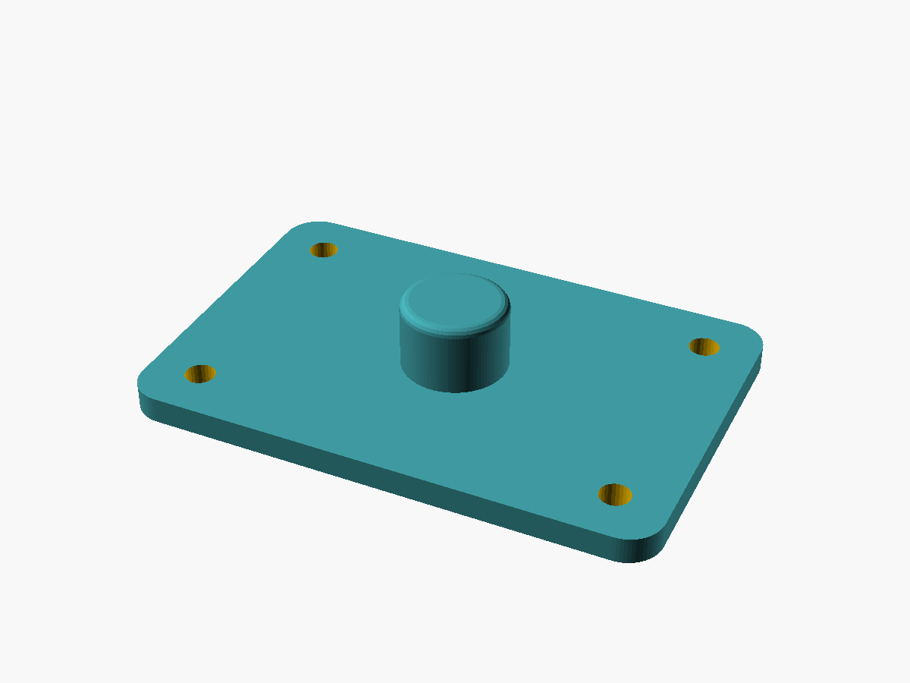

# scad-repo-template

Baseline shape and setup for OpenSCAD projects. Opinionated where OpenSCAD itself is
not: the language has no package manager, no project file, and no formal repo
convention, so this is a self-contained repo that renders headlessly and reproducibly.

The included part is a demo — a parametric mounting plate, annotated section by
section with the convention it illustrates. Replace it.



## Getting started

```bash
git clone --recurse-submodules <this-repo> myproject
cd myproject
make test
make stl        # -> out/*.stl
```

Already cloned without `--recurse-submodules`? Run `git submodule update --init`.

If you used GitHub's **Use this template** button, submodules are not copied — run
`git submodule update --init` after the first clone.

<!-- <template-only> -->
To start a *new project* from this template, use `scripts/template_sync.py new` (see
[Project setup](#project-setup)) rather than cloning or the template button: it also
writes the `.template.toml` that later keeps the project in sync with the template.
<!-- </template-only> -->

### Requirements

- **OpenSCAD.** The build prefers `openscad-nightly` and falls back to a stable
  `openscad`; anything from 2021.01 onward works. Run `make toolchain` to see which was
  picked. The nightly is strongly recommended — it has the manifold backend, which
  renders this repo's benchmark part in 0.33 s against 33 s under CGAL. Install it with
  `sudo snap install openscad-nightly`, or from <https://openscad.org/downloads.html>.
- **make**, and **git** for the vendored library.
- On Windows, run from Git Bash, or add `C:\Program Files\OpenSCAD\` to `PATH`.
- Headless PNG export usually needs a display: `xvfb-run make png`.

Nothing here requires the nightly: with only a stable `openscad` installed, every target
still works, just slower. CI builds both.

## Layout

```
src/                 # printable parts / assemblies — one .scad per output file
lib/                 # project-local reusable modules/functions (definitions only)
vendor/              # third-party libraries as git submodules
presets/             # Customizer parameter sets (.json), one per variant
tests/               # assert()-based .scad files, run headlessly
out/                 # rendered STL/PNG — gitignored
scripts/             # helper scripts if the Makefile isn't enough
docs/                # tracked images for this README
```

See [AGENTS.md](AGENTS.md) for the rule attached to each directory.

## Build

| Command | Result |
|---|---|
| `make` / `make stl` | Renders every `src/*.scad` to `out/*.stl` |
| `make png` | Renders previews to `out/*.png` (needs a display) |
| `make test` | Runs `tests/*.scad` |
| `make clean` | Removes `out/` |
| `make toolchain` | Prints the resolved binary, version, and backend |
| `make help` | Lists the targets |

`clean`, `help` and `toolchain` work even with no OpenSCAD installed; the build targets
fail immediately with an actionable message instead of a confusing render error.

Overrides:

```bash
make OPENSCAD=openscad                   # force the stable build
make OPENSCAD=/path/to/openscad          # non-PATH install
make OPENSCAD_CANDIDATES='foo bar'       # change the auto-detect search order
make FLAGS='--export-format=binstl'      # force flags (skips the manifold probe)
```

Resolution order: an explicit `OPENSCAD=` wins; otherwise the first of
`openscad-nightly openscad` found on `PATH`.

Variants — add explicit targets rather than generalising the pattern rule:

```bash
openscad -D 'plate_length=120' -o out/plate-long.stl src/example.scad
openscad -p presets/example.json -P large-m5 -o out/plate-large.stl src/example.scad
```

## Customizer parameters

Open the part in OpenSCAD and use **Window → Customizer**, or edit the block at the top
of `src/example.scad`.

| Parameter | Default | Range | Meaning |
|---|---|---|---|
| `plate_length` | 60 | 20–200 | Plate length (mm) |
| `plate_width` | 40 | 20–200 | Plate width (mm) |
| `plate_thick` | 3 | 1.5–10, step 0.5 | Plate thickness (mm) |
| `corner_round` | 4 | 0–10, step 0.5 | Vertical corner radius (mm) |
| `hole_count_x` | 2 | 1–6 | Holes along X |
| `hole_count_y` | 2 | 1–6 | Holes along Y |
| `hole_size` | `M3` | M2…M5 | Screw size; drives clearance diameter |
| `hole_margin` | 6 | — | Edge to hole centre (mm) |
| `add_boss` | `true` | bool | Add the centred boss |
| `boss_od` | 12 | 6–30 | Boss outer diameter (mm) |
| `boss_height` | 8 | 2–30 | Boss height (mm) |
| `boss_style` | `round` | round, hex | Boss profile |

Saved sets live in `presets/example.json` (`default`, `large-m5`, `plain`).

## Tests

`tests/*.scad` assert on the functions in `lib/`. Test functions, not geometry — there
is no good automated STL diff in the standard toolchain. For geometry regressions, CI
renders PNGs on every push; diff them by eye in the PR.

Note that OpenSCAD exits 0 even when an `assert()` fails (verified on both 2021.01 and
the 2026.08 nightly), so `make test` inspects the echo output rather than the exit code.
See AGENTS.md.

## Third-party libraries

Vendored as git submodules under `vendor/`, referenced by relative path:

```bash
git submodule add https://github.com/BelfrySCAD/BOSL2.git vendor/BOSL2
git commit -m "build: add BOSL2 submodule"
```

Bump deliberately:

```bash
git submodule update --remote vendor/BOSL2
git commit -am "build(vendor): bump BOSL2"
```

`vendor/` is never edited by hand.

## Print settings

Fill in per project: material, layer height, orientation, supports, infill.

## Releases

`out/` is gitignored. Attach STLs to a GitHub release from a tag-triggered job instead of
committing binaries.

## Project setup

<!-- <template-only> -->
From a checkout of this template (needs `python3` ≥ 3.11 and `git`; no Python ends up
in the new project):

```bash
python3 scripts/template_sync.py new ../myproject            # prompts for values
python3 scripts/template_sync.py new ../myproject -y --set project=myproject --set 'copyright_holder=Jane Doe'
make template-new CHILD=../myproject                          # same thing
```

That copies the files, substitutes the project name and copyright holder, adds the
`vendor/` submodules at this template's pinned commits, writes `.template.toml`, and
stages everything on a fresh `main` branch. Then, in the new project:
<!-- </template-only> -->

1. Review `git status` and make the first commit (Conventional Commits scope).
2. `pre-commit install`.
3. Confirm the toolchain: `make toolchain`, then `make test` and `make stl`.
4. Verify `out/` is ignored: `git status` shows no STL after step 3.
5. Replace `src/example.scad` and its `mounting_plate()` module; update this README's
   title, purpose, and parameter table, and `presets/example.json` to match.
6. Replace `docs/preview.png` (`make png && cp out/<part>.png docs/preview.png`).
7. Check `LICENSE` — MIT; the copyright holder is whatever was given at setup, or
   still the template's placeholder if nothing was.

## Staying in sync with the template

`.template.toml` records which template this project came from and the template commit
it was last synced to. From a checkout of the template:

```bash
python3 scripts/template_sync.py check  ../myproject    # what changed; writes nothing
python3 scripts/template_sync.py update ../myproject    # apply it and bump the pin
```

Each template file has a strategy, set in the template's `template.toml`:

| Strategy | Files | On update |
|---|---|---|
| `managed` | `.gitignore`, `.pre-commit-config.yaml`, `.gitmodules`, CI | Always brought to the template's version. Change them in the template, not here — a local edit is reported as drift. |
| `merge` | `Makefile`, `AGENTS.md` | Yours to extend; template changes are 3-way merged in. Conflicts are left as markers to resolve, like a git merge. |
| `seed` | the demo part, presets, tests, this README, `LICENSE` | Copied once at setup, never touched again. |

Override any file's strategy in `.template.toml` `[overrides]` — e.g. `".gitignore" = "merge"`
to add your own ignores, or `"Makefile" = "ignore"` once you have forked it for good.
`update` refuses to run on a dirty tree, so every sync is one reviewable commit.

## License

MIT — see [LICENSE](LICENSE). Update the copyright holder before publishing.
