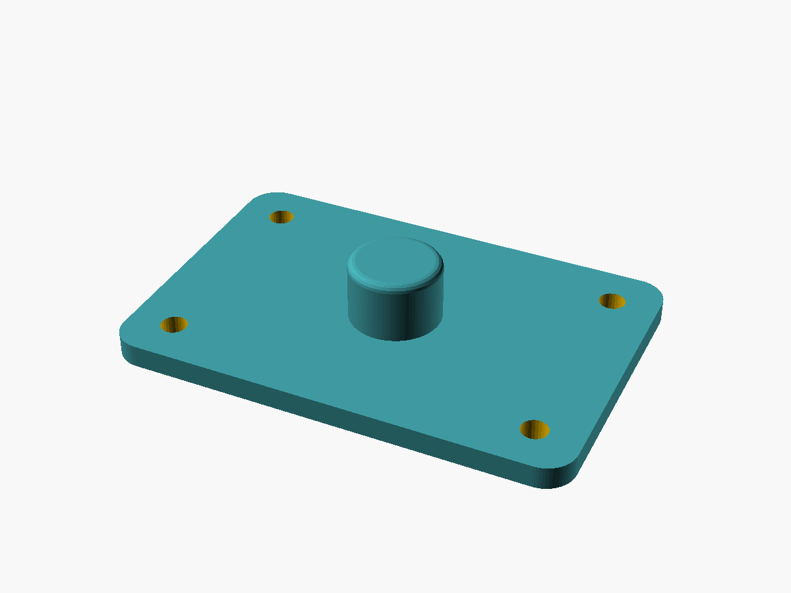

# scad-repo-template

Baseline shape and setup for OpenSCAD projects. Opinionated where OpenSCAD itself is
not: the language has no package manager, no project file, and no formal repo
convention, so this is a self-contained repo that renders headlessly and reproducibly.

It gives a project a fixed layout, a Makefile that renders STLs and previews with
whichever OpenSCAD is installed, assert-based tests, pre-commit hooks, CI on both the
nightly and stable toolchains, a README, and optionally a documentation site built with
MkDocs for GitHub Pages. Projects created from the template can pull in its later
changes with a small sync tool.

The included parts are a demo — a parametric mounting plate, annotated section by
section with the convention it illustrates, and a cap that fits over its boss — with the
measurements they share in one file and an assembly that seats the cap on the plate.
Replace them.

## Repository shape

| Path | Holds |
|---|---|
| `src/` | All the project's own OpenSCAD source. Each `.scad` file directly in it is a printable part, one per STL, with a single top-level call at the bottom, so it renders on its own and other files can `use` it. |
| `src/params.scad` | Every measurement of the parts, which each part includes, so they always fit each other. Not a part: it draws nothing. See [Parts, measurements and the assembly](development.md#parts-measurements-and-the-assembly). |
| `src/assembly.scad` | The parts placed together, to check how they fit. Never printed — `make png` previews it and `make test` checks it still evaluates. |
| `src/lib/` | Project-local modules and functions. Definitions only — no top-level geometry, no reliance on globals — so any file can `use <>` them safely. Not parts: nothing in it is rendered. |
| `vendor/` | Third-party libraries as git submodules, pinned to exact commits and never edited. BOSL2 is included. |
| `tests/` | `.scad` files that `assert()` on the functions in `src/lib/`, run headlessly by `make test`. |
| `docs/` | This documentation, and the images the README uses. |
| `scripts/` | Helper scripts, for whatever the Makefile can't reasonably do. |
| `out/` | Rendered STLs, PNGs and test logs. Gitignored — attach release files to GitHub releases instead. |
| `site/` | The built documentation site. Gitignored. |
| `.github/workflows/` | CI. `render.yml` tests and renders on both OpenSCAD toolchains; `docs.yml` builds this site and publishes it to GitHub Pages. |
| `Makefile` | Every build, test and documentation command — see [Development](development.md). |
| `mkdocs.yml` | Documentation site settings and page order. |
| `pyproject.toml`, `uv.lock` | The documentation toolchain: MkDocs and its theme, locked to exact versions. |
| `.pre-commit-config.yaml` | The checks run before every commit. |
| `AGENTS.md` | Instructions for coding agents working in the repository. |
| `.template.toml` | Only in a project created from the template: the template commit the project was last synced with, its sync settings, and the commands to run a sync — see [Syncing with the template](template-sync.md). |

Alongside these sit `README.md`, `LICENSE`, `CLAUDE.md`, `.gitignore`, and `.gitmodules`
(the submodule URLs).

A project gets the documentation site — the pages in `docs/`, `mkdocs.yml`,
`pyproject.toml` and `uv.lock`, `make docs` and the `docs.yml` workflow — only if it asks for one when it is created; otherwise its
README is its documentation. Either way, it starts from generic pages, not these.

The template itself has more files that never reach a project as they are:
`template.toml`, which says how each file is kept in sync; the sync tool
`scripts/template_sync.py` and its tests; its own `README.md`, preview image and the pages
of this site; and `child/`, the generic README and documentation pages a project gets
instead.

A part in `src/` pulls in modules from `src/lib/` and `vendor/` by relative path, never
through `OPENSCADPATH`, so every checkout renders the same way — from `make`, in CI, or
by double-clicking the file.

## Tools

| Tool | What it does here |
|---|---|
| [OpenSCAD](https://openscad.org/) | Renders the parts. The Makefile prefers `openscad-nightly`, whose manifold backend is far faster on CSG-heavy parts, and falls back to a stable `openscad`; any version from 2021.01 on works. |
| [BOSL2](https://github.com/BelfrySCAD/BOSL2) | A widely used OpenSCAD library of shapes, attachments, rounding and threading. Vendored as a submodule; the demo part uses it. |
| [GNU Make](https://www.gnu.org/software/make/) | The one entry point for rendering, testing and building the docs. It picks which OpenSCAD to run and works around OpenSCAD's quirks — such as a failed `assert()` still exiting 0. |
| [Git](https://git-scm.com/) | Version control, with submodules pinning each vendored library to an exact commit. |
| [Python](https://www.python.org/) | The language of the tooling, never of the parts: pre-commit, MkDocs, and the template sync tool. |
| [uv](https://docs.astral.sh/uv/) | Installs and runs every Python tool, along with the Python version it needs. The documentation toolchain is declared in `pyproject.toml` and locked in `uv.lock`. |
| [pre-commit](https://pre-commit.com/) | Checks every commit: fixes trailing whitespace and final newlines, rejects files over 500 KB (usually an STL committed by accident), checks JSON files parse, scans for credentials with [detect-secrets](https://github.com/Yelp/detect-secrets), and evaluates each changed `.scad` file with OpenSCAD. |
| [MkDocs](https://www.mkdocs.org/) with [Material for MkDocs](https://squidfunk.github.io/mkdocs-material/) | Builds this site from the Markdown in `docs/`, and a project's site if it has one. `make docs` runs pinned versions of both through uv. |
| [GitHub Actions](https://docs.github.com/en/actions) | CI: tests and renders every push on both OpenSCAD toolchains, uploads the renders, and builds the documentation. |
| [GitHub Pages](https://docs.github.com/en/pages) | Hosts the documentation site, published from `main` by the docs workflow. |
| [Xvfb](https://www.x.org/) | A virtual display, so PNG previews render without a screen (`xvfb-run make png`) — in CI, or on a headless machine. |
| Template sync tool | `scripts/template_sync.py`, which lives only in the template. It creates projects from the template and later brings the template's changes into them, 3-way merging files that both sides edit. It has no dependencies beyond git. |

## Documentation

- [Getting started](getting-started.md) — requirements, installation, and setting up a
  new project.
- [Development](development.md) — building, variants, tests, pre-commit hooks, vendored
  libraries, the documentation site, and releases.
- [Parts](parts.md) — what each part is, its parameters, and how to print it.
- [Syncing with the template](template-sync.md) — checking a project against the
  template and pulling in its changes.
